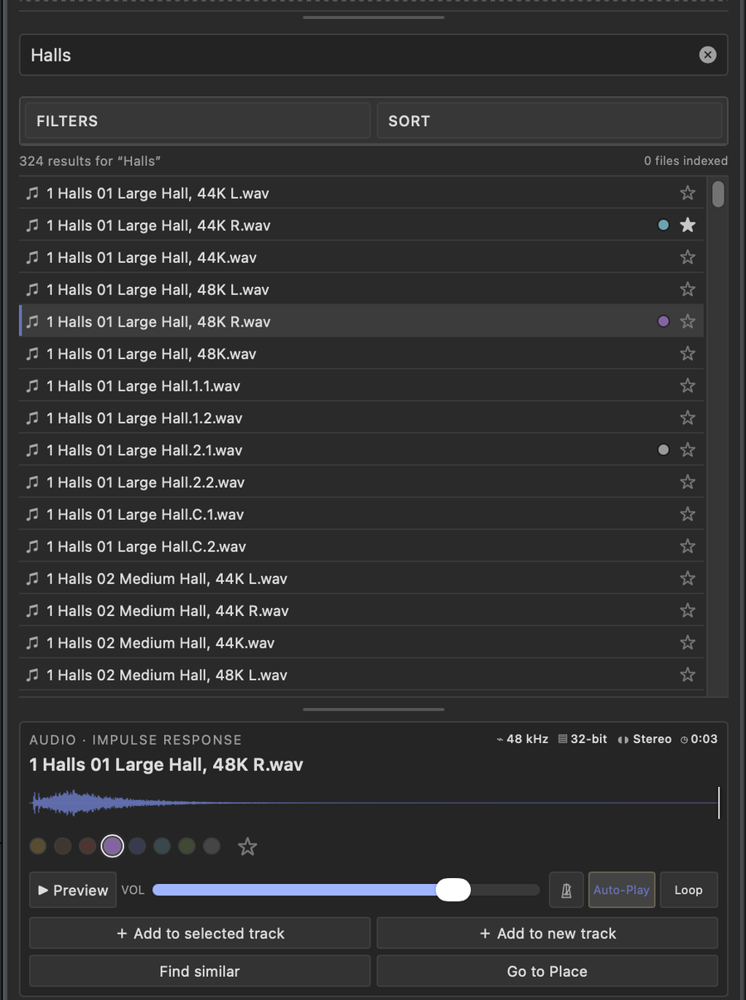
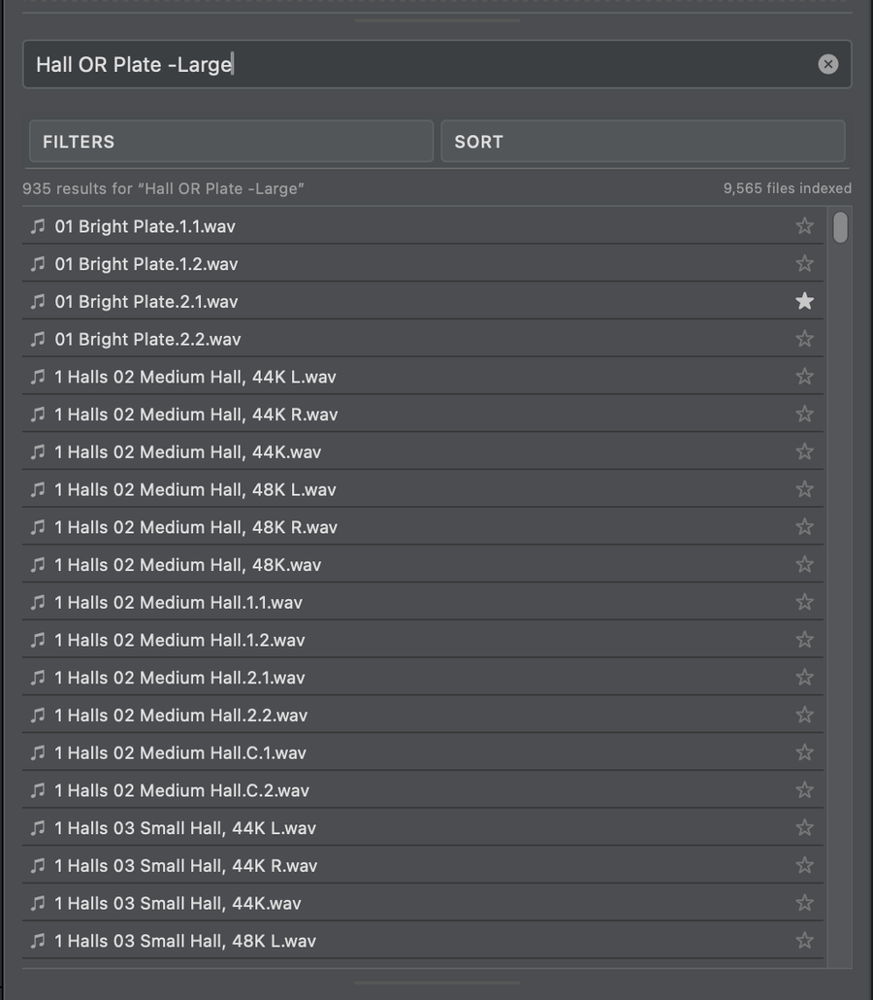
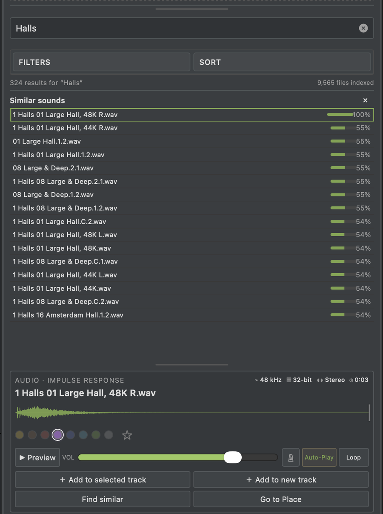
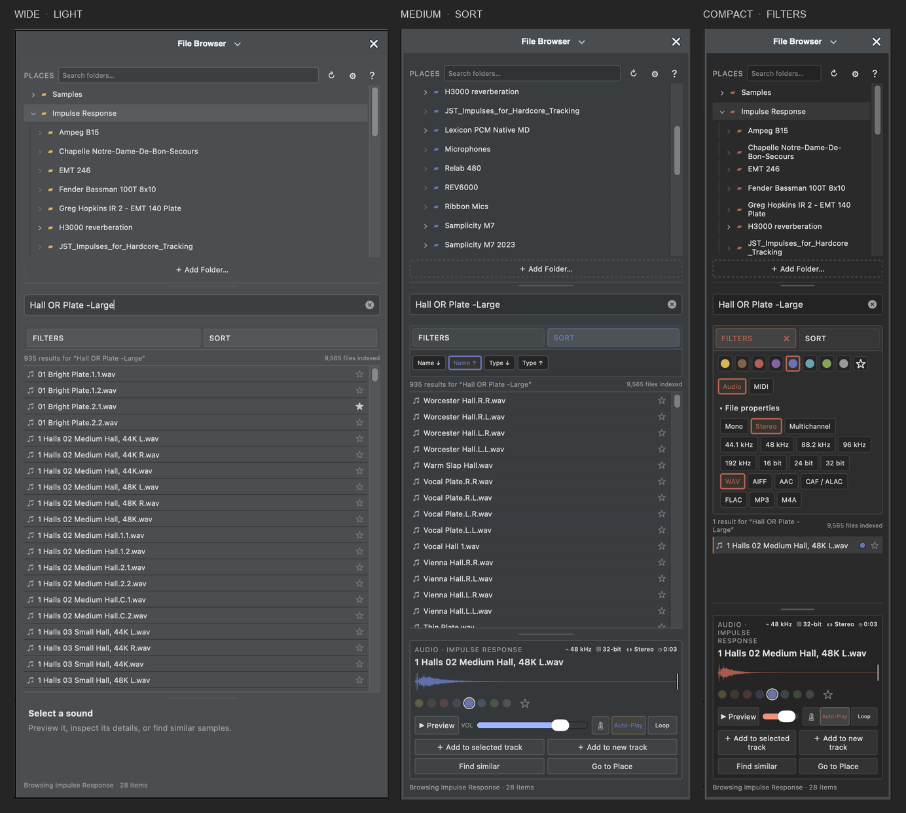
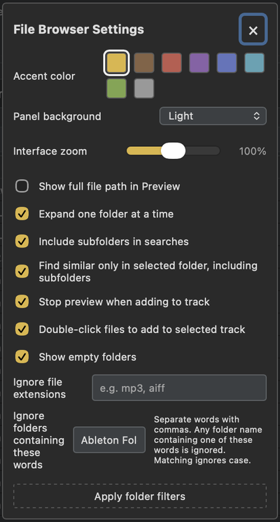

# File Browser for LUNA

**Find the right sound, hear it in context, and bring it into your session — without leaving LUNA.**

File Browser puts your sample library directly in LUNA. Search across Places, narrow results with practical filters, audition audio or MIDI, compare similar sounds, and add the result to your selected track or a new one. Tempo sync lets audio previews follow your LUNA session tempo.



## Find sounds quickly

- Browse your LUNA Places in a folder tree, or search folder names.
- Search filenames with phrases, `OR` choices, and exclusions such as `kick -loop`.
- Include subfolders when searching, and limit Find Similar to the selected folder when useful.
- Filter by Audio or MIDI, favorite status, file color, channels, sample rate, bit depth, and supported file format.
- Sort by name or type in either direction.



## Preview before you add

Select a result to see its waveform and audio details, including sample rate, bit depth, channel layout, and duration. Adjust preview level, turn Auto-Play or Loop on, or sync audio preview to the session tempo. When LUNA is already playing, a tempo-synced preview can queue for the next bar's beat one.

Add the sound to the selected track or create a new track. Optional double-click import and keyboard shortcuts help keep the workflow moving. MIDI files can be previewed and added to an instrument track.

## Compare similar sounds

Find Similar audio or MIDI files while keeping the selected sound as the reference. Choose whether to search the full library or just the selected folder and its subfolders. While a scan is running, selecting another folder redirects it; closing Similar Sounds cancels it.



## Adaptive panel layouts

The interface adapts across wide, medium, and compact Add On panel widths. Places, search, filters, results, and preview remain arranged for the available space.



## Keep your library organized

Mark a sound with the favorite star or one of the color swatches in its preview. Both are stored per LUNA session. Settings include accent and panel background choices, interface zoom, folder filtering, and preview behavior.



## Install

Download `File-Browser-1.0.69.lunaaddon` from the [Releases](https://github.com/fourdogslong/Luna-File-Browser-Add-On/releases) page and open it to install in LUNA.

## Build from source

Use Node.js 22 or later with the [LUNA Builder SDK](https://github.com/uaudio-labs/luna-builder-sdk):

```sh
npm install
npm run build
node /path/to/ua-luna-builder/sdk/cli.js pack
```

The Add On ID is `com.fourdogslong.file_browser`. LUNA Universe reads the Add On icon from the packaged `.lunaaddon` attached to the release.

## Support

If you enjoy this Add On and would like to support my work, consider [sponsoring me on GitHub](https://github.com/sponsors/fourdogslong). You can also use the **Sponsor** button at the top of this repository.
