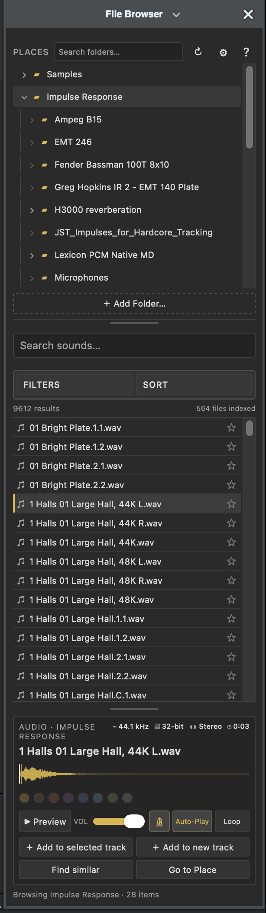

# File Browser for LUNA

Search and preview audio and MIDI from your LUNA Places, then import sounds to the selected track. The Add On ID is `com.fourdogslong.file_browser`.



## Features

- Browse Places and search within the current folder, with optional subfolder search.
- Filter and sort by file type, audio properties, favorites, and file colors.
- Preview audio and MIDI, loop previews, and sync audio preview tempo to the LUNA session.
- Find similar audio or MIDI, then add audio or MIDI to the selected track or a new track.
- Use keyboard shortcuts while the Add On is focused.

## Build

Install Node.js 22 or later and the [LUNA Builder SDK](https://github.com/uaudio-labs/luna-builder-sdk) plugin first. Then:

```sh
npm install
npm run build
```

To package for LUNA Universe, run the builder CLI from the installed plugin:

```sh
node /path/to/ua-luna-builder/sdk/cli.js pack
```

Attach the generated `.lunaaddon` to a GitHub release. LUNA Universe reads the icon from that release package. The Add On appears under **Add Ons → Browsers** when installed in LUNA.